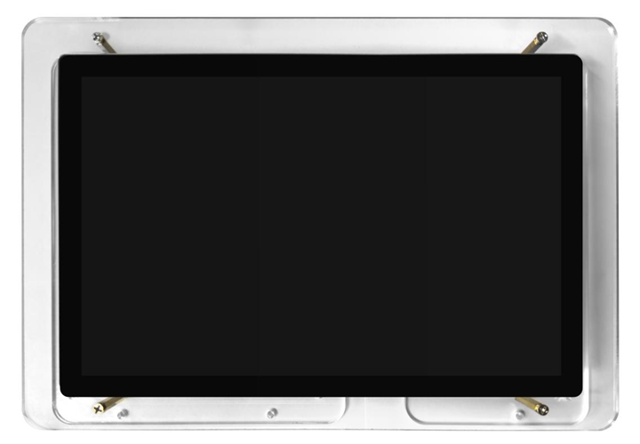
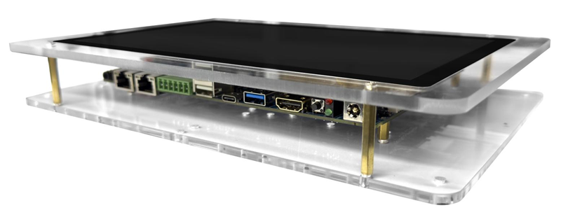
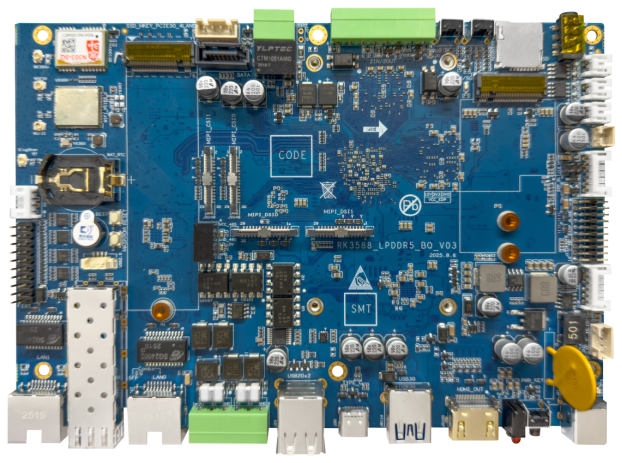
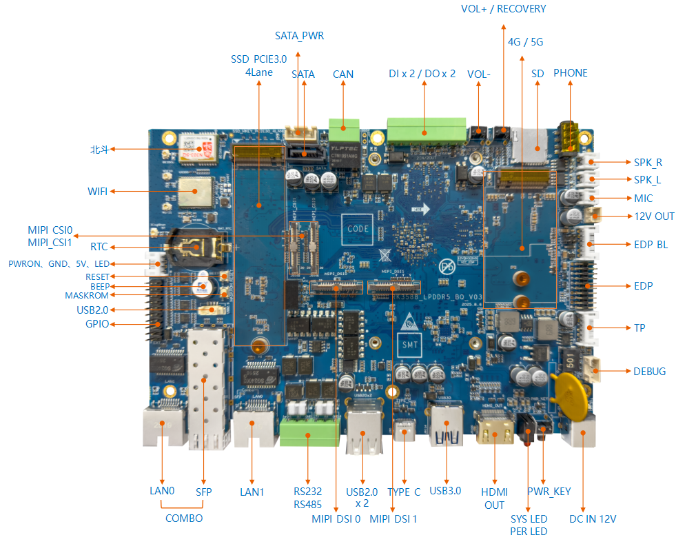
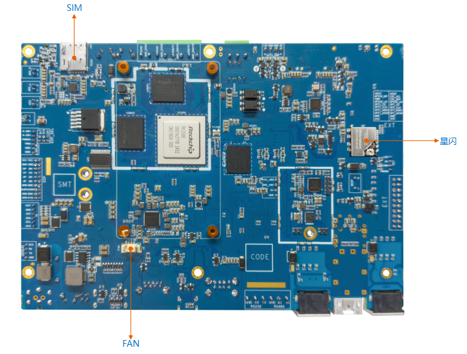
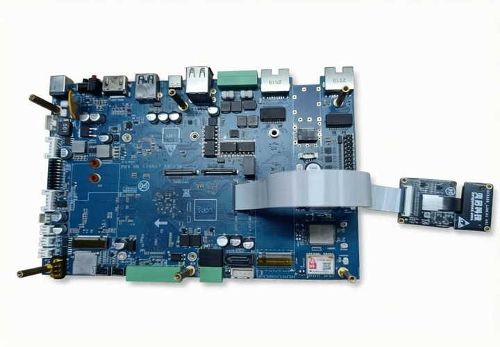

# Bearkey BQ3588HM Development Kit

**Overview**

The Bearkey BQ3588HM Development Kit (Model: BQ3588HM) is based on the Rockchip RK3588, integrating a quad-core Cortex-A76 and a quad-core Cortex-A55 processor with a main frequency of 2.4GHz. It is equipped with a Mali-G610 GPU and a 2D acceleration engine, supporting multiple graphics standards for a smooth visual experience. It also supports 8K video decoding and 60Hz refresh rate output, and integrates a 6TOPS NPU (Neural Processing Unit). It enables the private deployment of ultra-large-scale parameter models under the Transformer architecture and supports deep learning frameworks including Caffe, Pytorch, OnnxNN, etc. The Bearkey RK3588 Development Board supports Bluetooth, Wi-Fi, NearLink, Beidou/GPS positioning, and features rich expansion interfaces, as well as multiple audio and video input/output interfaces including MIPI display, EDP display, HDMI display, dual-channel MIPI camera/USB camera, and supports headphone, microphone socket, and speaker socket. It is configured with dual Gigabit adaptive RJ45 Ethernet ports, supports 4G/5G internet access via expansion modules, comes with 8GB RAM and 64GB storage, and supports TF card, solid-state drive (SSD)/SATA hard disk expansion. It has abundant external interfaces and communication methods including RS485, RS232, DI, DO, USB, etc.
The appearance of the Bearkey BQ3588HM Development Kit is shown in Figure 1:







    Figure 1: Appearance of Bearkey BQ3588HM Development Kit

**I. Development Board Details**

**1. Front Interface Schematic of Bearkey BQ3588HM Development Kit**



    Figure 2: Front Interface Schematic of Bearkey BQ3588HM Development Kit

2.**Reverse Interface Schematic of Bearkey BQ3588HM Development Kit**



    Figure 3: Reverse Interface Schematic of Bearkey BQ3588HM Development Kit

**II. Development Board Specifications**

The Rockchip RK3588 integrates a quad-core Cortex-A76 and a quad-core Cortex-A55 processor with a maximum main frequency of 2.4GHz, and can be widely used in the field of embedded artificial intelligence.
The core specifications of the Bearkey BQ3588HM Development Kit are shown in Table 1:

| Chips, Processors, Storage |                                                                                                                             |
| :------------------------- | --------------------------------------------------------------------------------------------------------------------------- |
| SoC                        | Rockchip RK3588                                                                                                             |
| CPU                        | ARM Cortex-A76×4+ARM Cortex-A55×4                                                                                         |
| GPU                        | G610, supporting OpenGLES 1.1, 2.0, and 3.2, OpenCL up to 2.2, Vulkan1.2, and a proprietary 2D hardware acceleration engine |
| NPU                        | 6.0TOPs                                                                                                                     |
| RAM                        | 8GB and above LPDDR5                                                                                                        |
| ROM                        | 64GB eMMC 5.1                                                                                                               |

    Table 1: Core Specification List of Bearkey BQ3588HM Development Kit

The interface specification description of the Bearkey BQ3588HM Development Kit is shown in Table 2:

| Interface Specification Description of Bearkey BQ3588HM Development Kit |                                                                                                                                                                                  |
| ----------------------------------------------------------------------- | -------------------------------------------------------------------------------------------------------------------------------------------------------------------------------- |
| Power Supply                                                            | DC IN 9-36V (12V3A recommended)                                                                                                                                                  |
| Indicators                                                              | 1 x SYS LED、1 x PWR LED                                                                                                                                                         |
| Debugging                                                               | 1x Debug Serial Port                                                                                                                                                             |
| Buttons                                                                 | 1x Vol+/Recovery Button, 1 x Vol-, 1x Reset Button, 1x Power Key, and LED Socket (4Pins)                                                                                         |
| Display Interfaces                                                      | 1 x HDMI OUT (8K@60Hz), 1 x EDP (4K@60Hz), 2 x 4-lane MIPI_DSI, supporting TYPE-C video output                                                                                  |
| Camera Interfaces                                                       | 2 x MIPI_CSI (4LANE), FPC socket; the supporting OV13855 module can reach a maximum resolution of 4224×3136                                                                     |
| USB                                                                     | 1 x TYPE-C USB3.0, 1 x USB3.0 TYPE-A HOST, 2 x USB2.0 HOST, supporting USB cameras                                                                                               |
| Serial Ports                                                            | 1 x RS232、1 xRS485、1 x CAN，2 x TTL UART                                                                                                                                       |
| GPIO Interfaces                                                         | 14 x GPIO (including PWM/I2C/SPI)                                                                                                                                              |
| G-sensor                                                                | 1x G-sensor                                                                                                                                                                      |
| Buzzer                                                                  | 1xBuzzer                                                                                                                                                                         |
| Combo + LAN                                                             | LAN 1 / SFP + LAN 2                                                                                                                                                              |
| Cellular Data                                                           | 1x M.2 socket, supporting 4G/5G modules                                                                                                                                          |
| Wireless Network                                                        | Supporting WIFI6 5GHz/2.4GHz, 2 antennas                                                                                                                                         |
| Bluetooth                                                               | BT5.0                                                                                                                                                                            |
| NearLink                                                                | Supporting SLE1.0 protocol                                                                                                                                                       |
| Audio                                                                   | 1x HDMI audio output, 1x Headphone output (3.5mm, CTIA), left and right channel SPK socket (2Pins 3W@4Ω), 1 x MIC socket (2Pins)                                                |
| SIM Card Slot                                                           | 1 x SIM（Nano-SIM）                                                                                                                                                              |
| SD Card Slot                                                            | 1 x SD card slot, supporting SDXC UHS-II                                                                                                                                         |
| Location                                                                | Supporting Beidou, GPS                                                                                                                                                           |
| DIDO                                                                    | 2 DI, 2 DO (OD gate)                                                                                                                                                             |
| Solid-State Drive Interface                                             | 1 x M.2 M-key socket, PCIE3.0 (4LANE), supporting solid-state drives                                                                                                             |
| Hard Disk Interface                                                     | 1 x SATA3.0 socket                                                                                                                                                               |
| Other Expansion Interfaces                                              | 1 x DC OUT 12V; CPU Fan: 1 x FAN_CPU (12V); USB: 1 x USB2.0 (4Pins socket); Touch Screen Interface: 1 x I2C touch screen socket; RTC Battery: 1 x BAT_RTC (independent RTC chip) |

    Table 2: Interface Specification Description of Bearkey BQ3588HM Development Kit

**III. Installation of Development Board Accessories:**

**1. Camera Module Installation is shown in the figure below:**



    Figure 4: Camera Installation Diagram of Bearkey BQ3588HM Development Kit

**IV. Application Scenarios of the Development Board**

The Bearkey BQ3588HM Development Kit is suitable for scenarios such as intelligent NVR, cloud terminals, IoT gateways, industrial control, information release terminals, multimedia advertising machines, and can also be widely used in the field of embedded artificial intelligence.

**V. Setting Up the Development Environment**

**1. Install Dependent Tools**

The installation command is as follows:

```
sudo apt-get update && sudo apt-get install git ssh make gcc libssl-dev liblz4-tool expect expect-dev g++ patchelf chrpath gawk texinfo diffstat binfmt-support qemu-user-static live-build bison flex fakeroot cmake gcc-multilib g++-multilib unzip device-tree-compiler ncurses-dev libgucharmap-2-90-dev bzip2 expat gpgv2 cpp-aarch64-linux-gnu libgmp-dev libmpc-dev bc python-is-python3 python2 git-core gnupg build-essential zip curl zlib1g-dev libc6-dev-i386 libncurses5 lib32ncurses5-dev x11proto-core-dev libx11-dev lib32z1-dev libgl1-mesa-dev libxml2-utils xsltproc fontconfig vim git-lfs ruby openssl libtinfo5 genext2fs ccache default-jdk u-boot-tools mtools mtd-utils scons gcc-arm-none-eabi libelf-dev libglvnd-dev doxygen
```

**Note:**
The above installation command is applicable to Ubuntu 22.04. For other versions, use the corresponding installation commands according to the package names.

**2. Obtain Standard System Source Code**

**Prerequisites**

1.Register a Gitee account.
2.Register the Gitee SSH public key, refer to Gitee Help Center.
3.Install the Git client and git-lfs, and configure user information.

```
git config --global user.name "yourname"

git config --global user.email "your-email-address"

git config --global credential.helper store
```

4.Install the Gitee repo tool by executing the following commands:

```
curl -s https://gitee.com/oschina/repo/raw/fork_flow/repo-py3 \>
/usr/local/bin/repo \#If you do not have permission, download it to another directory and configure it to the environment variable

chmod a+x /usr/local/bin/repo

pip3 install -i https://pypi.tuna.tsinghua.edu.cn/simple requests
```

**Steps to Obtain Source Code**

1.Download via repo + ssh (public key registration required, refer to Gitee Help Center):

```
repo init -u git@gitcode.com:openharmony/manifest.git -b master --no-repo-verify

repo sync -c

repo forall -c 'git lfs pull'
```

2.Download via repo + https:

```
repo init -u https://gitcode.com/openharmony/manifest.git -b master --no-repo-verify

repo sync -c

repo forall -c 'git lfs pull'
```

**Execute prebuilts**

Execute the script in the root directory of the source code to install the compiler and binary tools:

```
bash build/prebuilts_download.sh
```

The downloaded prebuilts binaries are stored in the OpenHarmony_2.0_canary_prebuilts directory in the same directory as OpenHarmony by default.

**VI. Compilation and Debugging**

**1. Compilation**

Perform the following operations in the Linux environment:

1.Enter the root directory of the source code and execute the following command to compile the version:

./build.sh -p bq3588  # Start compilation

2.Check the compilation result. After compilation is completed, the log displays the following:

```
post_process

=====build bq3588 successful.

2025-12-04 10:11:11
```

All files generated by compilation are archived in the out/bq3588/ directory, and the resulting image is output to the out/bq3588/packages/phone/images/ directory.

3.After completing the source code compilation, proceed to image burning.

**2.Burning Tool**

Download and use the burning tool:

Tool path: bq3588/tools/RKDevTool_v3.28_for_window.zip

For the burning instructions, refer to "Development Tool User Manual_v1.0.pdf" in RKDevTool_v3.28_for_window.zip.

**VII. Contact**

[Xiamen Bearkey Technology Co., Ltd. - Bearkey - Official Website](https://www.bearkey.com.cn/product/RK3588工业主板.html?type=OpenHarmony&name=RK3588工业主板&id=26)