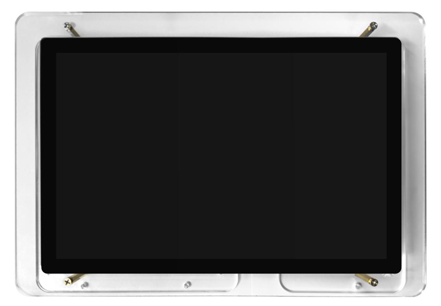
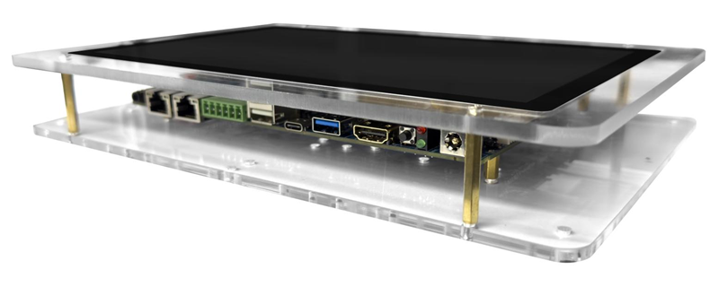
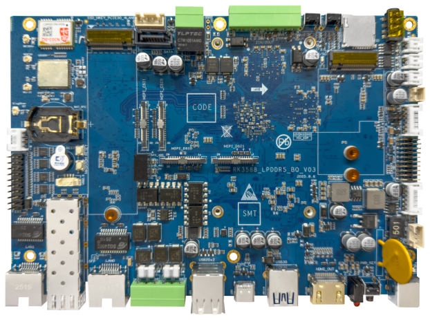
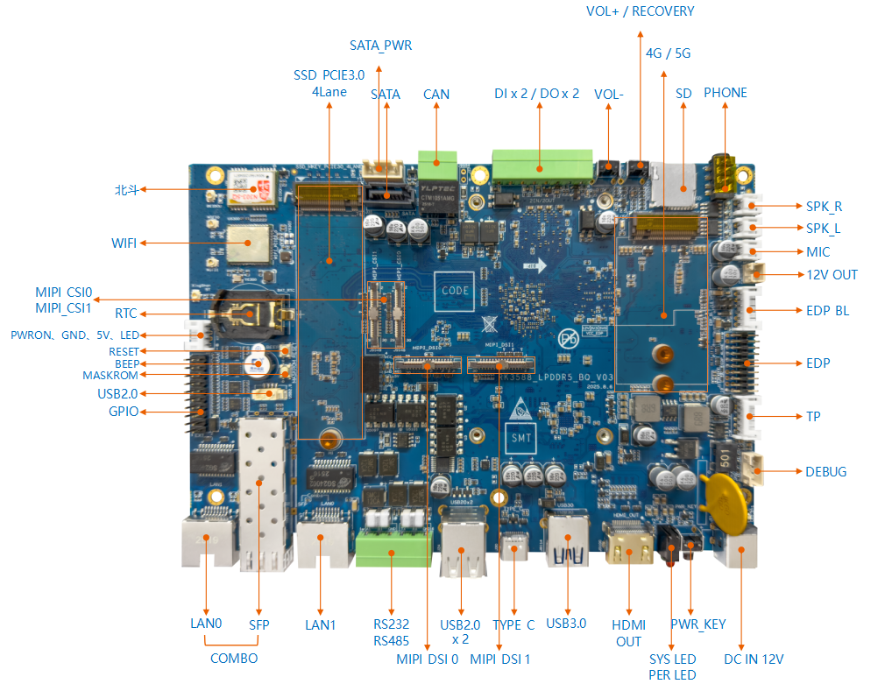
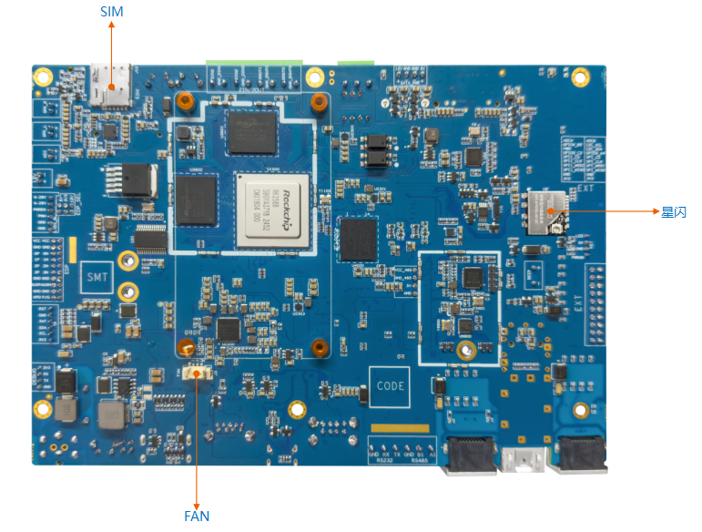
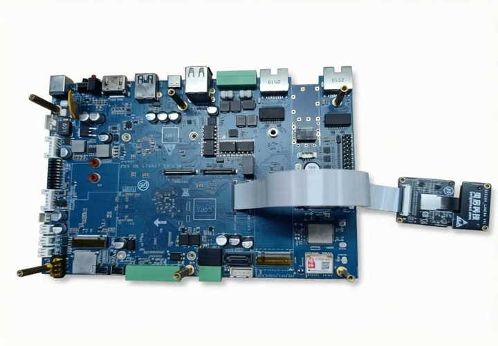

# 贝启BQ3588HM开发套件

## 简介

贝启BQ3588HM开发套件，型号BQ3588HM是基于Rockchip RK3588，集成四核Cortex-A76和四核Cortex-A55核心，主频2.4GHz，配备Mali-G610 GPU及2D加速引擎，支持多种图形标准，实现流畅视觉体验，支持8K视频解码和60Hz刷新率输出，集 成 6TOPS 算 力NPU。支持Transformer架构下超大规模参数模型的私有化部署。支 持 深 度学 习 框 架:Caffe、Pytorch、OnnxNN等。贝启RK3588开发板支持蓝牙、Wi-Fi、星闪、北斗GPS定位，拥有丰富的扩展接口，支持多种音视频输入输出接口，包括MIPI显示、EDP显示、HDMI显示，双路MIPI摄像头\USB摄像头，支持耳机、麦克风座子、喇叭座子；配置双千兆自适应RJ45以太网口，支持扩展模组4G/5G上网，配置8GB内存和64GB存储，支持TF卡、固态硬盘\SATA硬盘扩展，具备丰富外部接口与通信方式，包括RS485、RS232、DI、DO、USB等。

贝启BQ3588HM开发套件外观图如图1所示：







    图1：贝启BQ3588HM开发套件外观图

## 开发板详情

### 贝启BQ3588HM开发套件正面接口示意图



    图2：贝启BQ3588HM开发套件正面接口示意图

### 贝启BQ3588HM开发套件反面接口示意图



    图3：贝启BQ3588HM开发套件反面接口示意图

## 开发板规格

Rockchip RK3588集成四核Cortex-A76和四核Cortex-A55核心，主频高达2.4GHz，可广泛应用于嵌入式人工智能领域。

贝启BQ3588HM开发套件核心规格如表1所示：

| 芯片、处理器、存储 |                                                                                         |
| :----------------- | --------------------------------------------------------------------------------------- |
| SoC                | Rockchip RK3588                                                                         |
| CPU                | ARM Cortex-A76×4+ARM Cortex-A55×4                                                     |
| GPU                | G610 支持OpenGLES 1.1, 2.0, and 3.2, OpenCL up to 2.2 and Vulkan1.2，专有2D硬件加速引擎 |
| NPU                | 6.0TOPs                                                                                 |
| RAM                | 8GB 及以上 LPDDR5                                                                       |
| ROM                | 64GB eMMC 5.1                                                                           |

    表1 贝启BQ3588HM开发套件核心规格清单

贝启BQ3588HM开发套件接口规格说明如表2所示：

| 贝启BQ3588HM开发套件接口规格说明 |                                                                                                                                     |
| -------------------------------- | ----------------------------------------------------------------------------------------------------------------------------------- |
| 电源                             | DC IN 9 -36V 推荐12V3A                                                                                                              |
| 指示灯                           | 1 x SYS LED、1 x PWR LED                                                                                                            |
| 调试                             | 1x 调试串口                                                                                                                         |
| 按键                             | 1x Vol+/Recovery按键、1 x VoL-、1x Reset按键、1xPower key及LED座子(4Pins)                                                           |
| 显示接口                         | 1 x HDMI OUT（8K@60Hz）、1 x EDP（4K@60Hz）、2 x  4-lane MIPI_DSI、支持TYPEC视频输出                                              |
| 摄像头接口                       | 2 x MIPI_CSI（4LANE），FPC座子，配套OV13855模组最大分辨率可达 4224×3136                                                            |
| USB                              | 1 x TYPE-C USB3.0、1 x USB3.0 TYPE-A HOST、2 x USB2.0 HOST，支持USB摄像头                                                           |
| 串口                             | 1 x RS232、1 xRS485、1 x CAN，2 x TTL UART                                                                                          |
| GPIO接口                         | 14 x GPIO（含PWM/I2C/SPI）                                                                                                         |
| G-sensor                         | 1x G-sensor                                                                                                                         |
| 蜂鸣器                           | 1x蜂鸣器                                                                                                                            |
| Combo + LAN                      | LAN 1 / SFP + LAN 2                                                                                                                 |
| 蜂窝数据                         | 1xM.2座子，可支持4G/5G模组                                                                                                          |
| 无线网络                         | 支持WIFI6 5GHz/2.4GHz, 2天线                                                                                                        |
| 蓝牙                             | BT5.0                                                                                                                               |
| 星闪                             | 支持SLE1.0协议                                                                                                                      |
| 音频                             | 1x HDMI音频输出、1x 耳机输出（3.5mm, CTIA）、左右声道SPK座子（2Pins 3W@4Ω）、1 x MIC座子（2Pins）                                  |
| SIM 卡                           | 1 x SIM（Nano-SIM）                                                                                                                 |
| SD卡槽                           | 1 x SD卡槽，支持SDXC UHS-II                                                                                                         |
| 定位                             | 支持北斗、GPS                                                                                                                       |
| DIDO                             | 2个DI，2个DO（OD门）                                                                                                                |
| 固态硬盘接口                     | 1 x M.2 M-key 座子，PCIE3.0（4LANE），支持固态硬盘                                                                                  |
| 硬盘接口                         | 1 x SATA3.0座子                                                                                                                     |
| 其它拓展接口                     | 1 xDC OUT 12VCPU风扇 : 1 x FAN_CPU（12V）USB : 1 x USB2.0(4Pins座子)触屏接口 ：1 x I2C 触屏座子RTC电池 ：1 x BAT_RTC（独立RTC芯片） |

    表2 贝启BQ3588HM开发套件接口规格说明

## 开发板配件安装

### 摄像头模组安装



    图4：贝启BQ3588HM开发套件camera安装图

## 开发板应用场景

贝启BQ3588HM开发套件适用于智能NVR、云终端、物联网网关、工业控制、信息发布终端、多媒体广告机等场景，亦可广泛应用于嵌入式人工智能领域。

## 搭建开发环境

### 安装依赖工具

安装命令如下：

```
sudo apt-get update && sudo apt-get install git ssh make gcc libssl-dev liblz4-tool expect expect-dev g++ patchelf chrpath gawk texinfo diffstat binfmt-support qemu-user-static live-build bison flex fakeroot cmake gcc-multilib g++-multilib unzip device-tree-compiler ncurses-dev libgucharmap-2-90-dev bzip2 expat gpgv2 cpp-aarch64-linux-gnu libgmp-dev libmpc-dev bc python-is-python3 python2 git-core gnupg build-essential zip curl zlib1g-dev libc6-dev-i386 libncurses5 lib32ncurses5-dev x11proto-core-dev libx11-dev lib32z1-dev libgl1-mesa-dev libxml2-utils xsltproc fontconfig vim git-lfs ruby openssl libtinfo5 genext2fs ccache default-jdk u-boot-tools mtools mtd-utils scons gcc-arm-none-eabi libelf-dev libglvnd-dev doxygen
```

**说明：**
以上安装命令适用于Ubuntu22.04，其它版本请根据安装包名称采用对应的安装命令。

### 获取标准系统源码

#### 前提条件

1）注册码云gitee账号。

2）注册码云SSH公钥，请参考[码云帮助中心](https://gitee.com/help/articles/4191)。

3）安装[git客户端](http://git-scm.com/book/zh/v2/%E8%B5%B7%E6%AD%A5-%E5%AE%89%E8%A3%85-Git)和[git-lfs](https://gitee.com/vcs-all-in-one/git-lfs?_from=gitee_search#downloading)并配置用户信息。

```
git config --global user.name "yourname"

git config --global user.email "your-email-address"

git config --global credential.helper store
```

4）安装码云repo工具，可以执行如下命令。

```
curl -s https://gitee.com/oschina/repo/raw/fork_flow/repo-py3 \>
/usr/local/bin/repo \#如果没有权限，可下载至其它目录，并将其配置到环境变量中

chmod a+x /usr/local/bin/repo

pip3 install -i https://pypi.tuna.tsinghua.edu.cn/simple requests
```

#### 获取源码操作步骤

1） 通过repo + ssh 下载（需注册公钥，请参考码云帮助中心）。

```
repo init -u git@gitcode.com:openharmony/manifest.git -b master --no-repo-verify

repo sync -c

repo forall -c 'git lfs pull'
```

2） 通过repo + https 下载。

```
repo init -u https://gitcode.com/openharmony/manifest.git -b master --no-repo-verify

repo sync -c

repo forall -c 'git lfs pull'
```

### 执行prebuilts

在源码根目录下执行脚本，安装编译器及二进制工具。

```
bash build/prebuilts_download.sh
```

下载的prebuilts二进制默认存放在与OpenHarmony同目录下的OpenHarmony_2.0_canary_prebuilts下。

## 编译调试

### 编译

在Linux环境进行如下操作:

1） 进入源码根目录，执行如下命令进行版本编译。

./build.sh -p bq3588  # 开始编译

2） 检查编译结果。编译完成后，log中显示如下：

```
post_process

=====build bq3588 successful.

2025-12-04 10:11:11
```

编译所生成的文件都归档在out/bq3588/目录下，结果镜像输出在out/bq3588/packages/phone/images/ 目录下。

3） 编译源码完成，请进行镜像烧录。

### 烧录工具

烧写工具下载及使用。

工具路径：bq3588/tools/RKDevTool_v3.28_for_window.zip

烧录说明文档见RKDevTool_v3.28_for_window.zip的 “开发工具使用文档_v1.0.pdf“

## 联系

[厦门贝启科技有限公司-Bearkey-官网](https://www.bearkey.com.cn/product/RK3588工业主板.html?type=OpenHarmony&name=RK3588工业主板&id=26)
